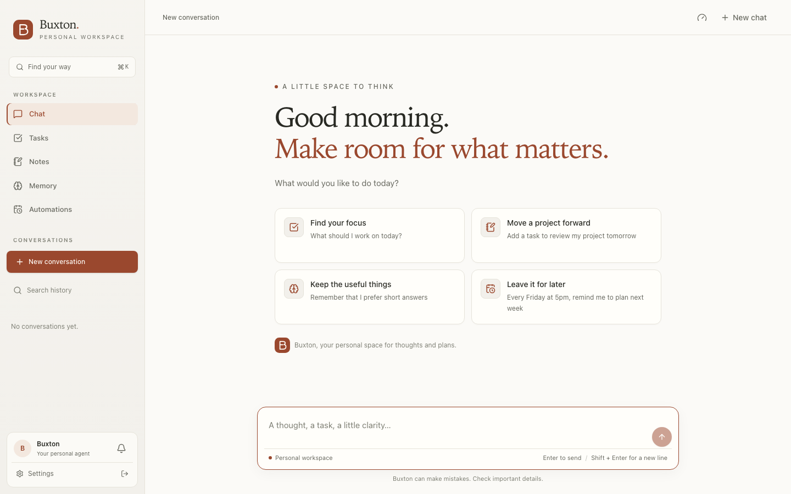

# Buxton workspace

Buxton is a frontend fork of [Talorys](https://github.com/rociiu/talorys), with a quieter personal workspace for chat, memory, tasks, notes, and automations. The application remains React + Vite. The backend, shared schemas, API transport, Pages Function, Cloudflare bindings, database migrations, and installer source are unchanged.

## Preview



[Dark theme](design/workspace-dark.png) · [Phone layout](design/workspace-mobile.png) · [Login](design/login-dark.png)

## Design

Warm paper surfaces, ink text, a clay accent, system sans-serif for controls and a system serif for the welcome screen. Dark mode uses deep olive surfaces and a warm peach accent. No web fonts, remote assets, new UI packages, or external runtime services were added.

- One sidebar holds workspace navigation and searchable conversations, replacing the original two-column navigation.
- The start screen offers four working suggestions, a timezone-aware greeting, and real recent conversations.
- A workspace palette (`⌘K` / `Ctrl+K`, or the search button) finds pages and loaded conversation titles. The sidebar retains the full server-backed history search, rename, and delete flows.
- Streaming responses, stop/retry/copy, tool activity, destructive-action approval, and task-plan cards retain their original behavior.
- Shared tokens and page headings carry through tasks, memories, notes, automations, settings, dialogs, and notifications.
- Mobile bottom navigation, IME-safe input, keyboard handling, reduced motion, light/dark themes, and safe-area spacing are preserved.
- The original folded-page B mark is used for the favicon and all PWA icons.

### References considered

| Project | What we took away | Integration choice |
| --- | --- | --- |
| [assistant-ui](https://github.com/assistant-ui/assistant-ui) | Legible threads, a distinct composer, inline tool and approval surfaces | Interaction inspiration; no library code copied |
| [LangChain Agent Chat UI](https://github.com/langchain-ai/agent-chat-ui) | Thread history and readable tool activity | Interaction inspiration; no LangGraph dependency |
| [CopilotKit](https://github.com/CopilotKit/CopilotKit) | Rich agent/application interaction | Evaluated; adopting its runtime would broaden the frontend-only change |

This is a custom frontend using the existing React components, not an assistant-ui or CopilotKit integration. The original MIT license and Talorys attribution remain in the repository.

## Run locally

From the repository root (Node.js 22+):

```sh
npm ci
npm run dev
```

The upstream local stack runs at `http://localhost:5173` with mock AI and local SQLite state. Its documented development password is `talorys-dev-password`; it is not a production password. The local ports 5173, 8787, and 8788 must be available. Development secrets and local state remain ignored by Git.

## Build and deploy this fork

```sh
npm run build
```

This builds the frontend, dry-runs the private Worker bundle, and packages **this checkout's** frontend in the existing installer templates. No deployment occurs during this command.

To provision a new installation using those local templates:

```sh
node packages/create-talorys/dist/cli.js /absolute/path/to/new-installation --name Buxton
```

To update an existing installation with this fork's complete bundle:

```sh
node packages/create-talorys/dist/cli.js update --dir /absolute/path/to/existing-installation
```

These installer commands perform a real Cloudflare deployment. The production architecture remains:

```text
Browser → Cloudflare Pages + /api Pages Function
                         → service binding → private Worker
                                           → Agents SDK / SQLite Durable Object
                                           → Workers AI
```

Keep the existing installation directory and its `talorys.json`. Follow the upstream deployment documentation for authentication and required permissions. A custom domain continues to be configured on the Pages project.

**Do not use `npx create-talorys@latest update` to install Buxton.** That downloads upstream Talorys and can replace the custom frontend. Pull and build this fork first, then use its local installer. The upstream update check still reports Talorys backend releases; it does not track this frontend fork.

For a frontend-only release to an existing Pages project, build `@talorys/web` and use that project's established Pages deployment process, preserving its `AGENT` service binding and production backend. The development `wrangler.jsonc` files contain local service names and should not be used as production targets.

## Verification

- `npm run lint`
- `npm run typecheck`
- `npm run test -w @talorys/web`
- `npm run build`
- `npm run test:e2e` (requires Playwright Chromium and the default local ports)

`tests/e2e/buxton.spec.ts` covers workspace search, modal keyboard/focus behavior, welcome scroll position, both themes, desktop, phone portrait and phone landscape, and composer/navigation overlap. Existing UI regressions exercise the real local Worker and Pages Function with mock AI. The existing login test was updated for the new visible heading.

Local verification does not establish production AI behavior, browser push delivery, or deployed custom-domain acceptance. No production deployment is part of this frontend change.
